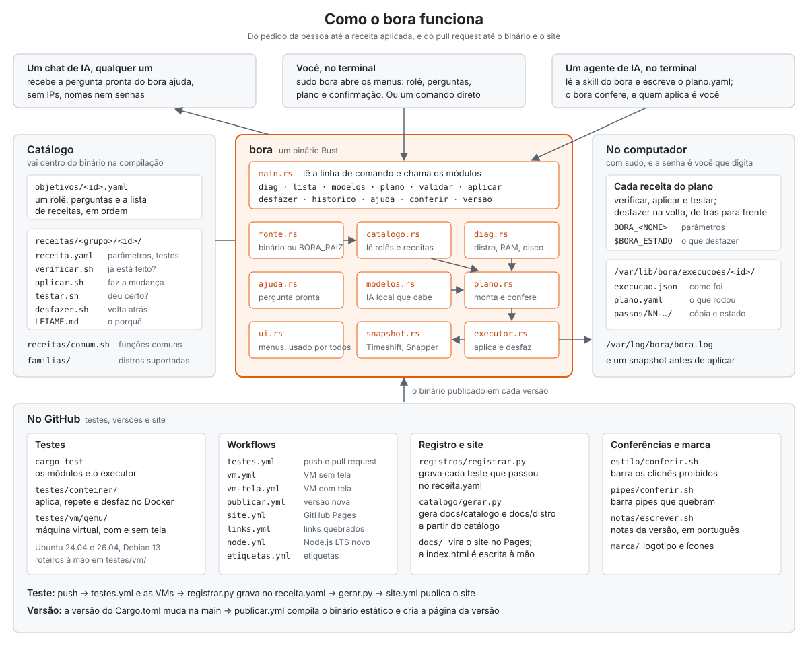

# Arquitetura

Como as peças do projeto se encaixam: quem usa o `bora`, o que tem dentro dele, o que ele deixa no computador e o que roda no GitHub.

## Quem usa

- **Você, no terminal.** `sudo bora` abre os menus: escolhe o rolê, responde as perguntas, revisa o plano e confirma. Cada passo também existe como comando avulso.
- **Um agente de IA.** Lê a skill do `bora` (que o rolê "Vibecodar" instala) e escreve um `plano.yaml`. O `bora validar` confere o plano, e quem aplica é você.
- **Um chat de IA.** Recebe a pergunta pronta do `bora ajuda`, já sem IPs, nomes de usuário e senhas.

## O catálogo

O que o `bora` sabe fazer mora em arquivos de texto, que vão para dentro do binário na compilação (`build.rs` e `include_dir`):

- `objetivos/<id>.yaml`: um rolê, com as perguntas e as receitas em ordem. O formato está em [`objetivos/README.md`](../objetivos/README.md).
- `receitas/<grupo>/<id>/`: uma receita, com `receita.yaml`, os quatro scripts (`verificar`, `aplicar`, `testar` e `desfazer`) e o `LEIAME.md`. As regras estão em [`receitas/README.md`](../receitas/README.md).
- `receitas/comum.sh`: as funções que todas as receitas usam para instalar pacotes, escrever arquivos e anotar o que desfazer.
- `familias/`: as distros suportadas e o que muda entre elas.

Para testar uma mudança sem recompilar, aponte `BORA_RAIZ` para a pasta do repositório.

## O `bora` por dentro

Um binário Rust, com um módulo por arquivo em `src/`:

| Módulo | O que faz |
|---|---|
| `main.rs` | Lê a linha de comando e chama os outros módulos |
| `fonte.rs` | Acha o catálogo: o embutido ou o da pasta em `BORA_RAIZ` |
| `catalogo.rs` | Lê e confere rolês e receitas |
| `diag.rs` | Descobre distro, memória, disco, rede e placa de vídeo |
| `modelos.rs` | Escolhe os modelos de IA locais que cabem na máquina |
| `plano.rs` | Monta o plano a partir de um rolê e confere se ele vale para esta máquina |
| `executor.rs` | Aplica e desfaz o plano, receita por receita |
| `snapshot.rs` | Tira o snapshot do sistema antes de aplicar (Timeshift, Snapper ou ostree) |
| `ajuda.rs` | Monta a pergunta pronta, sem dados sensíveis |
| `ui.rs` | Menus, cores e perguntas no terminal |

O caminho de um plano: `fonte` → `catalogo` → `plano` (com o `diag` e o `modelos`) → `executor` → `snapshot` e as receitas.

## No computador

- Para cada receita, o `executor` roda `verificar.sh`; se ainda falta algo, `aplicar.sh` e depois `testar.sh`. Os parâmetros chegam como `BORA_<NOME>`, e o que precisa ser desfeito fica em `$BORA_ESTADO`.
- Cada aplicação ganha uma pasta em `/var/lib/bora/execucoes/<id>/`, com o plano, a situação de cada passo e uma cópia das receitas. Assim o `bora desfazer` roda os mesmos scripts, mesmo depois de o `bora` ser atualizado.
- O registro fica em `/var/log/bora/bora.log`.

## No GitHub

- **Testes:** `cargo test`, as receitas em contêineres ([`testes/conteiner/`](../testes/conteiner/README.md)) e em máquinas virtuais com e sem tela ([`testes/vm/`](../testes/vm/README.md)), no Ubuntu 24.04 e 26.04 e no Debian 13.
- **Workflows:** estão listados em [`.github/workflows/`](../.github/workflows/README.md).
- **Registro e site:** quando um teste passa, o `registrar.py` grava o resultado no `receita.yaml`, o `gerar.py` refaz as páginas de `docs/catalogo/` e `docs/distro/`, e o `site.yml` publica a pasta `docs/` no GitHub Pages.
- **Versão:** quando a versão do `Cargo.toml` muda na `main`, o `publicar.yml` compila o binário estático e cria a página da versão.
- **Conferências:** `ferramentas/estilo/conferir.sh` barra os clichês, e `ferramentas/pipes/conferir.sh` barra os pipes que quebram com `pipefail`.

## Mudou o projeto? Mude o desenho

Comando, módulo, pasta, workflow ou fluxo novo ou mudado: atualize o [`arquitetura.svg`](arquitetura.svg) e este texto no mesmo pull request. O SVG é texto, com um comentário no topo explicando como mexer. Confira no navegador, no tema claro e no escuro, e abra o pull request.
