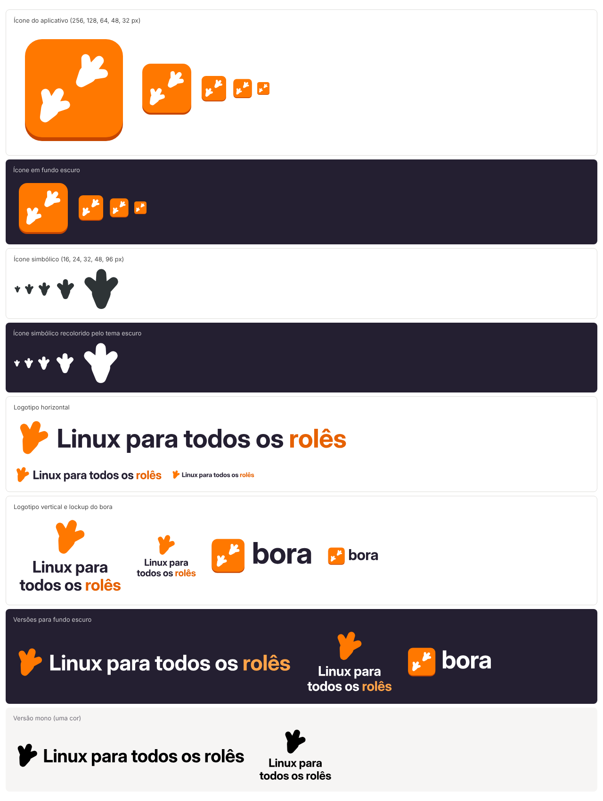

# Marca: logotipo e ícone

Identidade visual do projeto **Linux para todos os rolês** e do aplicativo **`bora`**, pronta para o README, o site, a interface gráfica de desktop e a distribuição como Flatpak ou pacote nativo da distro.



## Conceito

Pegadas de pinguim. O pinguim é o Linux; a pegada é o rolê (sair para dar uma volta) e também os passos testados que o `bora` segue, um de cada vez, com um jeito de voltar atrás.

- O **ícone do aplicativo** mostra duas pegadas em diagonal: alguém saindo para um rolê.
- O **símbolo do projeto**, usado no logotipo e no ícone simbólico, é uma pegada só.

Não há mascote de propósito. As diretrizes de ícones do GNOME desaconselham personagens, e o Tux tem autor e estilo próprios. A pegada lembra o pinguim sem desenhá-lo.

## Arquivos

| Arquivo | Para quê |
|---|---|
| `icones/hicolor/scalable/apps/br.com.brahm.Bora.svg` | Ícone colorido do aplicativo, desenhado na grade de 128×128 px do GNOME, com o perfil mais escuro na base. Escala de 32 px para cima. |
| `icones/hicolor/symbolic/apps/br.com.brahm.Bora-symbolic.svg` | Ícone simbólico, 16×16 px, uma cor só. O GTK o recolore conforme o tema; é o que aparece em cabeçalhos, notificações, bandeja e no modo de alto contraste. |
| `logotipo/logotipo-horizontal.svg` | Logotipo principal, para fundos claros. |
| `logotipo/logotipo-horizontal-escuro.svg` | O mesmo, com cores para fundos escuros. |
| `logotipo/logotipo-horizontal-mono.svg` | Uma cor só (`currentColor`), para impressão, bordado ou fundos onde as cores não funcionam. |
| `logotipo/logotipo-vertical.svg`, `-escuro.svg`, `-mono.svg` | Versão empilhada, para avatares, capas e espaços quadrados. |
| `logotipo/bora-horizontal.svg`, `-escuro.svg` | Ícone do aplicativo ao lado do nome `bora`, para a janela "Sobre", o site e a documentação. |
| `png/` | Exportações prontas: ícone de 32 a 512 px, ícone simbólico e logotipos em alta resolução. |
| `ferramentas/` | Os scripts que geram tudo isso. |

Os textos dos logotipos já estão convertidos em contornos. Nenhum arquivo depende de fonte instalada, e todos são SVG puro, sem filtros, imagens embutidas ou referências externas.

## Cores

A paleta é a do GNOME, para o ícone combinar com os outros no desktop.

| Uso | Nome na paleta | Hex |
|---|---|---|
| Face do ícone e marca do logotipo | Orange 3 | `#ff7800` |
| Perfil (base) do ícone | Orange 5 | `#c64600` |
| Palavra "rolês" em fundo claro | Orange 4 | `#e66100` |
| Palavra "rolês" em fundo escuro | Orange 2 | `#ffa348` |
| Texto em fundo claro | Dark 4 | `#241f31` |
| Pegadas sobre o laranja e texto em fundo escuro | Light 1 | `#ffffff` |
| Ícone simbólico (cor de referência; o GTK substitui) | | `#2e3436` |

## Tipografia

Inter Display, peso Bold, com espaçamento levemente fechado. A Inter é livre (SIL Open Font License 1.1) e vem empacotada nas distros: `fonts-inter` no Debian e no Ubuntu, `rsms-inter-fonts` no Fedora. Para textos ao lado da marca, use Inter ou a fonte padrão do sistema.

## Identificador do aplicativo

Flatpak, AppStream e os arquivos `.desktop` exigem um identificador em DNS reverso, e os arquivos de ícone precisam ter exatamente esse nome. Os arquivos usam **`br.com.brahm.Bora`**, a partir do domínio brahm.com.br, decidido em novembro de 2026.

- O domínio serve só de espaço de nomes. O Flatpak será distribuído por conta própria, como bundle ou repositório hospedado no GitHub, e não pelo Flathub, então não há verificação de domínio nem regra de nome de repositório a cumprir.
- O id diferencia maiúsculas e precisa ser idêntico nos ícones, no `.desktop`, no `<id>` do metainfo e no nome D-Bus do aplicativo. O `Bora` em CamelCase segue a convenção dos aplicativos GNOME; o comando no terminal continua `bora`.
- Mantenha o id estável desde a primeira versão: as atualizações de Flatpak e o GNOME Software reconhecem o aplicativo pelo id.
- Para trocar, renomeie os dois arquivos de ícone, ou rode o gerador com `APP_ID=novo.id python3 marca/ferramentas/gen.py marca`.

## Como o aplicativo usa os ícones

A pasta `icones/hicolor` já segue a estrutura do tema de ícones do Freedesktop. No pacote, ela vai para `/usr/share/icons/`; no Flatpak, para `/app/share/icons/`. O `.desktop` aponta para o identificador, sem extensão:

```ini
[Desktop Entry]
Type=Application
Name=Bora
Comment=Linux para todos os rolês
Exec=bora
Icon=br.com.brahm.Bora
Terminal=false
Categories=System;Utility;
```

No metainfo (`br.com.brahm.Bora.metainfo.xml`), o `<id>` precisa ser o mesmo identificador. No Flatpak, o `flatpak-builder` exporta sozinho os ícones de `/app/share/icons/hicolor/` cujo nome começa com o id, junto com o `.desktop` e o metainfo. É isso que faz o ícone aparecer no menu e no GNOME Software mesmo instalando por um bundle `.flatpak` ou por um repositório `.flatpakrepo` hospedado no GitHub. Para testar sem instalar nada:

```sh
cp -r marca/icones/hicolor ~/.local/share/icons/
gtk-update-icon-cache -f -t ~/.local/share/icons/hicolor
```

O aplicativo [App Icon Preview](https://flathub.org/apps/org.gnome.design.AppIconPreview), do time de design do GNOME, abre o SVG, mostra o ícone em vários tamanhos ao lado de outros e gera a variante "nightly" para builds de desenvolvimento.

## No README e no GitHub

O GitHub troca a imagem conforme o tema da pessoa:

```html
<picture>
  <source media="(prefers-color-scheme: dark)" srcset="marca/logotipo/logotipo-horizontal-escuro.svg">
  
</picture>
```

O `png/icone-512.png` serve de avatar e para lojas que pedem PNG. A imagem social do repositório (1280×640 px) pode ser montada com o logotipo horizontal sobre fundo branco ou `#241f31`.

## Regras de uso

- Deixe em volta do logotipo um respiro de pelo menos metade da altura da pegada.
- Não estique, não gire, não acrescente sombra ou contorno, não troque as cores fora da paleta acima.
- Em fotos e fundos coloridos, use a versão mono, em branco ou preto.
- Abaixo de 160 px de largura na tela, use só a pegada ou o ícone do aplicativo em vez do logotipo horizontal.

## Como regenerar

Tudo é gerado por código, então um ajuste na pegada ou na paleta se propaga para todos os arquivos.

```sh
python3 -m pip install fonttools uharfbuzz      # ou os pacotes da distro
python3 marca/ferramentas/gen.py marca            # SVGs
python3 marca/ferramentas/export.py marca         # PNGs; precisa de Node.js e do Playwright com Chromium
```

- `ferramentas/pegada.py` desenha a pegada (três dedos com membrana) como um único caminho SVG, em qualquer escala e rotação.
- `ferramentas/texto.py` converte texto em contornos com HarfBuzz (kerning correto) e fontTools.
- `ferramentas/gen.py` monta o ícone, o simbólico e os logotipos. A variável `INTER_DIR` aponta para a pasta da Inter (padrão: `/usr/share/fonts/opentype/inter`).

## Licença

Mesma licença do projeto. A Inter continua sob a SIL OFL 1.1; os contornos embutidos nos logotipos são desenho derivado, não a fonte, e podem ser usados livremente.
